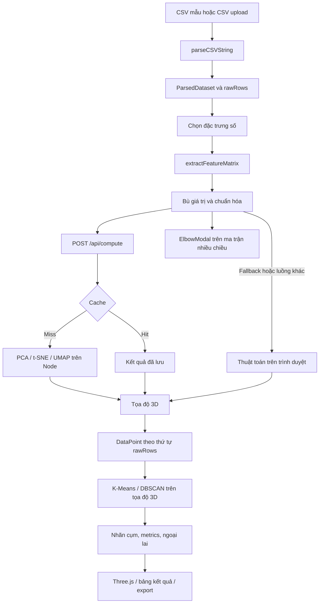

# BÁO CÁO ĐÁNH GIÁ SOURCE CODE

**Dự án:** Interactive High-Dimensional Data Explorer  
**Ngày đánh giá:** 03/11/2026  
**Phạm vi:** Source code, cấu hình, dependencies và dữ liệu hiện có trong repository; không so sánh phiên bản cũ.

## Thông tin xác minh và giới hạn

Repository ứng dụng thực tế:

```text
C:\Users\hary0\Documents\Project JS_TS Group2\Interactive-High-Dimensional-Data-Explorer\Interactive-High-Dimensional-Data-Explorer
```

Tại thời điểm đánh giá, Git ở trạng thái `main...group2/main`, working tree sạch. Workspace bên ngoài là một repository Git khác chưa có commit.

Quá trình đánh giá chỉ đọc file và chạy lệnh kiểm tra an toàn; không sửa source, không đổi branch, không cài dependencies, không chạy build/test hoặc khởi động ứng dụng. File báo cáo này được tạo sau đó theo yêu cầu của người dùng.

Các lỗi được xác định bằng phân tích tĩnh; tác động trên trình duyệt chưa được kiểm thử trực tiếp. Báo cáo phân biệt hành vi thấy trong source, hệ quả suy ra từ luồng code và nội dung chưa được xác minh bằng thực thi.

**Nhận định chính:** Dự án đã có phần lớn luồng khám phá dữ liệu 3D, nhưng chưa thể đánh giá là ổn định hoặc đáng tin cậy về kết quả phân tích do còn lỗi ở khởi tạo dữ liệu, hợp đồng API, cache, chỉ số đánh giá và đồng bộ state.

## PHẦN 1 — PROJECT OVERVIEW

### 1.1. Mục tiêu và phạm vi thực tế

Ứng dụng là công cụ khám phá dữ liệu bảng bằng cách:

1. Đọc CSV và tự nhận diện ID, nhãn, các đặc trưng số.
2. Cho phép chọn ít nhất ba đặc trưng số.
3. Tiền xử lý và giảm chiều xuống ba tọa độ.
4. Phân cụm trên các tọa độ 3D.
5. Hiển thị, chọn, kiểm tra và lọc điểm.
6. Xem chỉ số, lưu thông tin thí nghiệm và xuất CSV/PNG.

Wisconsin Breast Cancer và Wholesale Customers là hai dataset được backend tự seed. Những CSV khác trong `data/` không được tự động đưa vào danh sách ứng dụng.

MNIST hiện mới có dữ liệu `.npz`, tài liệu và script Python tải dữ liệu. **Chưa có đường đi từ `.npz` vào giao diện, chưa có hiển thị ảnh chữ số hoặc pipeline MNIST hoàn chỉnh.** Script Python chỉ tải, làm phẳng, chia pixel cho 255 và in thông tin; frontend/backend không gọi script này. Bằng chứng: [data_loader.py][loader], dòng 17–34.

### 1.2. Technology stack

Phiên bản được đọc từ manifest và lockfile, không lấy từ phần giới thiệu README.

| Thành phần | Công nghệ hiện tại | Vai trò |
|---|---|---|
| Frontend | React, TypeScript | SPA và điều phối state |
| Phiên bản khóa | React `19.3.1`, TypeScript `6.0.3` | Theo `package-lock.json` |
| Build/dev server | Vite `5.4.21` | Phục vụ frontend, proxy API |
| Đồ họa | Three.js `^0.169.0`, OrbitControls | WebGL 3D, camera, raycasting |
| UI | Tailwind CSS v4, Lucide React, CSS | Bố cục, biểu tượng, styling |
| Backend | Express `4.22.3`, Node.js, tsx | REST API và tính toán |
| CSV | PapaParse | Parse CSV; xuất CSV kết quả |
| Upload | Multer, memory storage | Nhận file vào RAM |
| Lưu trữ | MongoDB driver `7.7.0` | Dataset, thí nghiệm, compute cache |
| Fallback | `Map`/array trong RAM | Vận hành khi không kết nối MongoDB |
| Thuật toán | TypeScript tự triển khai | PCA, t-SNE, UMAP, K-Means, DBSCAN |
| Hạ tầng mẫu | Nginx | TLS, reverse proxy, giới hạn request |
| Tiện ích độc lập | Python, NumPy, TensorFlow/Keras | Tải MNIST |

Nguồn: [package.json][package], [package-lock.json][lock].

**SQLite chưa được sử dụng:** có dependency `sqlite3`, nhưng không có import hoặc thao tác SQLite trong source ứng dụng. Fallback thực tế là RAM.

### 1.3. Khởi động và vận hành theo cấu hình hiện tại

Các lệnh dưới đây chỉ được đối chiếu với source, chưa được thực thi trong đợt đánh giá.

| Lệnh | Hành vi |
|---|---|
| `npm run dev` | Chạy frontend Vite, cổng mặc định 3000 |
| `npm run server` | Chạy backend bằng `tsx watch` |
| `npm run dev:all` | Chạy đồng thời backend và frontend |
| `npm run dev:host` | Frontend lắng nghe `0.0.0.0:3000` để truy cập LAN |
| `npm run build` | Chạy `tsc`, sau đó `vite build` |
| `npm run preview` | Chạy Vite preview |

Frontend proxy `/api` đến `http://localhost:5000`; backend dùng `PORT` hoặc 5000. MongoDB dùng `MONGODB_URI`, tên database trong code cố định là `cancer_explorer`. Backend chỉ bắt đầu lắng nghe sau khi `initDatabase()` hoàn tất.

Bằng chứng: [vite.config.ts][vite], dòng 24–32; [server/index.ts][server], dòng 53 và 483–491; [server/db.ts][db], dòng 38–41.

**Yêu cầu Node trong README chưa khớp dependencies:** MongoDB driver đã khóa yêu cầu Node `>=20.19.0`, trong khi README ghi Node 18 trở lên. Bằng chứng: [package-lock.json][lock], dòng 4114–4125.

## PHẦN 2 — SYSTEM ARCHITECTURE

### 2.1. Cấu trúc module

| Module | Trách nhiệm thực tế |
|---|---|
| [src/main.tsx][main] | Mount React trong `StrictMode` |
| [src/App.tsx][app] | Điều phối dataset, cấu hình, pipeline, metrics, live animation, lọc điểm, export và modal |
| [src/types/index.ts][types] | Kiểu dữ liệu dùng chung giữa frontend/backend |
| [src/utils/dataParser.ts][parser] | Parse CSV, suy luận schema, tạo và chuẩn hóa ma trận |
| [src/utils/typeGuards.ts][guards] | Kiểm tra một phần cấu trúc response tại runtime |
| [src/utils/apiClient.ts][client] | Client HTTP có unwrap response và token; hiện chưa được các luồng chính sử dụng |
| `src/algorithms/` | Các thuật toán dùng được ở cả trình duyệt và Node |
| [ControlSidebar.tsx][sidebar] | Dataset, feature selection, cấu hình và nút chạy |
| [ThreeCanvas.tsx][canvas] | Scene, camera, render điểm, tooltip, chọn điểm, biplot, snapshot |
| [MetricsPanel.tsx][panel] | Metrics, phân bố cụm, danh sách ngoại lai, lưu/lịch sử |
| [DataInspector.tsx][inspector] | Chi tiết điểm và thao tác loại điểm |
| [RawDataModal.tsx][raw] | Bảng dữ liệu gốc, tìm kiếm, phân trang, export |
| [DatasetManagerModal.tsx][manager] | UI quản lý dataset |
| [ElbowModal.tsx][elbow] | Chạy thử K-Means với nhiều K |
| [ExperimentsModal.tsx][experiments] | Hiển thị lịch sử đã lưu |
| [SecurityModal.tsx][security] | Trạng thái backend, DB, RAM, cache và hướng dẫn LAN |
| [TooltipSlider.tsx][slider] | Component slider tùy chỉnh; hiện không được import vào luồng ứng dụng |
| [server/index.ts][server] | Express middleware, routes, validation, compute endpoint, error handler |
| [server/db.ts][db] | MongoDB, RAM fallback, seed, CRUD, cache, system health |
| [server/auth.ts][auth] | User/token giả lập và role guard |
| [server/errors.ts][errors], [response.ts][response] | Các lớp lỗi và định dạng response |
| `public/` | CSV mẫu được frontend tải trực tiếp |
| `data/` | Các bộ dữ liệu bổ sung |
| [nginx/nginx.conf][nginx] | Cấu hình triển khai mẫu, chưa xác minh đang được sử dụng |

Kiến trúc hiện tại là một SPA và một Express server. Không có router frontend, state store tập trung bên ngoài React, Web Worker hoặc worker thread cho tác vụ tính toán.

### 2.2. Luồng dữ liệu tổng thể



Ba điểm kiến trúc quan trọng:

- **Luồng giảm chiều chính** gửi cấu hình clustering với `method: 'None'` tới backend. Sau đó thao tác phân cụm chạy ở trình duyệt. Backend vẫn có khả năng giảm chiều và phân cụm trong cùng `/api/compute` nếu được gọi trực tiếp. Bằng chứng: `App.tsx:538–546`, `server/index.ts:344–387`.
- Khi backend lỗi hoặc response không hợp lệ, frontend có thể tự tính toán bằng cùng các module thuật toán. Một số luồng, gồm phân cụm từ dữ liệu chưa giảm chiều và viewport phụ, tính trực tiếp ở trình duyệt.
- Chuẩn hóa trong `ThreeCanvas` chỉ là phép tịnh tiến và scale đồng đều để vừa khung nhìn. Nó xảy ra **sau tính toán**, không phải chuẩn hóa đặc trưng đầu vào.

### 2.3. Quan hệ giữa dữ liệu gốc, tọa độ và nhãn

Trong pipeline thông thường:

```text
rawRows[i]
  ↔ matrix[i]
  ↔ coordinates[i]
  ↔ clusterAssignments[i]
  ↔ DataPoint[i]
```

Không có bước loại dòng trong `extractFeatureMatrix`, nên thứ tự ban đầu được giữ. Ground truth được tách khỏi ma trận feature và dùng để đánh giá/hiển thị.

Tuy nhiên, hợp đồng đồng bộ này chưa được bảo vệ đầy đủ:

- `isComputeResult()` không xác nhận số tọa độ và số nhãn bằng số bản ghi.
- Khi thiếu tọa độ, `App` âm thầm dùng `[0,0,0]`.
- ID từ CSV không được kiểm tra duy nhất.
- Live animation tiếp tục gán tọa độ bằng index, kể cả sau khi danh sách điểm đã bị lọc.

Bằng chứng: [typeGuards.ts][guards], dòng 53–73; [App.tsx][app], dòng 580–599, 975–987 và 1070–1082.

### 2.4. API hiện có

| Nhóm | Endpoint |
|---|---|
| Auth giả lập | `POST /api/auth/login`, `GET /api/auth/me` |
| Trạng thái | `GET /api/health`, `GET /api/system-health`, `POST /api/test-db` |
| Dataset | `GET /api/datasets`, `GET/PATCH/DELETE /api/datasets/:id`, `POST /api/datasets/upload` |
| Tính toán | `POST /api/compute` |
| Cache | `DELETE /api/cache` |
| Thí nghiệm | `GET/POST /api/experiments` |

Không có route xóa thí nghiệm, khôi phục một thí nghiệm vào workspace, hoặc tải trực tiếp MNIST.

## PHẦN 3 — FEATURE INVENTORY

“Có triển khai” nghĩa là có đường xử lý trong source; không đồng nghĩa đã vượt qua kiểm thử runtime.

| Chức năng | Mục đích, đầu vào → đầu ra | Module | Trạng thái và giới hạn |
|---|---|---|---|
| Nạp dữ liệu mẫu | CSV tĩnh/DB → dataset | `App`, `db` | Có; CSV cancer hiện xung đột validation tên cột |
| Upload CSV | File → parsed dataset và bản ghi DB/RAM | `App.handleFileUpload`, API upload | Có; parse cả client và server; chưa giới hạn kích thước multipart trong Multer |
| Parse CSV | Chuỗi CSV → rows/schema | `dataParser.parseCSVString` | Có BOM handling, dynamic typing, delimiter detection, kiểm tra cấu trúc |
| Nhận diện ID/label/features | Rows → vai trò cột | `dataParser` | Heuristic; không có UI sửa kết quả nhận diện |
| Kho dataset | Danh sách/detail → chọn, đổi tên, xóa | `DatasetManagerModal`, API CRUD | Có code; danh sách đang đọc sai response envelope |
| Xem dữ liệu gốc | Rows → bảng tìm kiếm/phân trang | `RawDataModal` | Có; mặc định 50 dòng/trang, lựa chọn 25/50/100/200 |
| Xem dữ liệu thô 3D | Ba feature đầu được chọn → XYZ | `App.rawPreviewPoints` | Có; giá trị thiếu/không hợp lệ hiển thị thành 0 |
| Chọn thuộc tính | Feature list → selected features | `ControlSidebar`, `App` | Có tìm kiếm, chọn tất cả/bỏ chọn; tối thiểu ba feature |
| Xử lý thiếu/invalid | Rows → ma trận số | `extractFeatureMatrix` | Có ý định mean imputation; `null` và chuỗi rỗng bị ép thành 0 |
| Chuẩn hóa | Ma trận → ma trận đã scale | `extractFeatureMatrix` | Có `z-score`, `min-max`, `none`; không có robust scaler |
| PCA | Ma trận → tọa độ, variance, components | `pca.ts` | Có; solver tự viết, có vấn đề với rank thấp |
| t-SNE | Ma trận và cấu hình → tọa độ | `tsne.ts` | Có; tính toàn bộ cặp điểm; chưa có UI chỉnh iterations |
| UMAP | Ma trận và cấu hình → tọa độ | `umap.ts` | Có phiên bản tự triển khai, chưa xác minh tương đương implementation tham chiếu |
| Live t-SNE | Ma trận/state → tọa độ từng bước | `liveOptimization`, `App` | Có play/pause/reset; chưa đồng bộ metrics, nhãn và tập điểm sau lọc |
| K-Means | Tọa độ 3D, K → nhãn, centroid, inertia | `kmeans.ts`, `App` | Có K-Means++; UI K=2–10 |
| DBSCAN | Tọa độ 3D, ε, minPts → nhãn/noise | `dbscan.ts`, `App` | Có; tìm láng giềng bằng quét toàn bộ |
| Tìm K | Ma trận feature → WCSS/Silhouette với K=2–8 | `ElbowModal` | Có; chọn K bằng max Silhouette, không tính knee tự động |
| Metrics | Tọa độ/nhãn → Silhouette, ARI, counts | `metrics.ts`, `MetricsPanel` | Có; còn lỗi trường hợp đặc biệt và đồng bộ sau chỉnh dữ liệu |
| Phát hiện ngoại lai | Khoảng cách 3D → cờ outlier | `metrics.ts` | Có heuristic toàn cục/theo cụm và DBSCAN noise |
| Lọc/xóa/khôi phục điểm | DataPoints → tập điểm hiển thị mới | `App`, `DataInspector`, `MetricsPanel` | Có; không sửa CSV/DB; metrics chưa cập nhật đầy đủ |
| Trực quan hóa 3D | DataPoints → WebGL | `ThreeCanvas` | Có instancing, camera, grid, axes và morph animation |
| Trực quan hóa 2D | Dữ liệu → biểu đồ 2D | — | Chưa thấy chế độ scatter 2D |
| Tương tác điểm | Pointer → hover/select/focus | `ThreeCanvas`, `DataInspector` | Có; chọn và xóa theo ID |
| Tô màu | Nhãn/cụm/feature → màu điểm | `ThreeCanvas` | Có; legend còn thiếu và không hoàn toàn phản ánh dữ liệu |
| PCA biplot | Components → vector đặc trưng | `ThreeCanvas` | Có hướng vector Top N; độ dài không phản ánh magnitude |
| Phương sai PCA | Variance → số liệu/thanh tỷ lệ | `MetricsPanel` | Có ba PC; chưa có bảng Top 5 loadings theo từng PC |
| So sánh hai viewport | Hai embedding → hai canvas | `App`, `ThreeCanvas` | Có phần xử lý, nhưng chưa có điều khiển UI kích hoạt |
| Data Story | Dataset → chuỗi bước tự động | `App.handlePlayStory` | Có; phụ thuộc timer và closure, chưa bảo đảm chạy đúng pipeline được mô tả |
| Lưu thí nghiệm | Cấu hình/metrics → record | `App`, API experiments | Có; metadata chưa đủ tái lập và `datasetId` đang dùng tên dataset |
| Xem lịch sử | Records → bảng | `ExperimentsModal` | Có UI; luồng fetch đang đọc sai response |
| Export kết quả CSV | DataPoints → CSV có XYZ, cụm, feature số | `App.handleExportCSV` | Có; không xuất đầy đủ mọi cột gốc |
| Export bảng gốc | Các dòng đang lọc → CSV | `RawDataModal` | Có; tự ghép CSV, header chưa được escape |
| Export PNG | Canvas → PNG | `ThreeCanvas` | Có; chụp canvas hiện tại, không gồm các panel DOM |
| Theo dõi hệ thống | API → RAM, uptime, DB latency, cache count | `db`, `SecurityModal` | Có; fetch lúc mở/làm mới, chưa có monitoring liên tục đầy đủ |
| Cache | Request → kết quả RAM/MongoDB | `server/index`, `db` | Có; khóa dữ liệu chưa đầy đủ, RAM cache không phải LRU đúng nghĩa |
| Phân quyền | Token → role guard | `auth.ts` | Mô phỏng; không phải xác thực an toàn |
| Theme sáng/tối | State/localStorage → theme | `App`, một số modal | Có state, nhưng chưa có nút đổi theme được nối vào UI; nhiều component bỏ qua theme |

Các chức năng **chưa thấy được triển khai** trong luồng ứng dụng: HDBSCAN, NMI, trustworthiness, PCA-50, sampling có seed, import `.npz`, xem ảnh MNIST, khôi phục đầy đủ thí nghiệm và sinh synthetic dataset.

## PHẦN 4 — ALGORITHM ANALYSIS

### 4.1. Tiền xử lý dữ liệu

Nguồn: [dataParser.ts][parser], dòng 10–233.

#### Nhận diện schema

- ID dựa trên tên `id`, hậu tố `_id`, hoặc `index`.
- Cột được xem là numeric khi ít nhất 85% giá trị không rỗng là số.
- Cột numeric chỉ được giữ làm feature khi có hơn một giá trị phân biệt.
- Label dựa trên tên quen thuộc hoặc cột categorical ít giá trị.
- Nếu chưa có label, cột có 2–10 giá trị phân biệt có thể được chọn làm label và bị loại khỏi features.

Heuristic này có thể lấy một thuộc tính số hợp lệ làm label. Ngoài ra, một cột categorical xuất hiện trước có thể chiếm vai trò label trước khi gặp cột tên `target`/`diagnosis`. Không có cơ chế xác nhận hoặc sửa vai trò cột.

#### Tạo ma trận và imputation

Đầu vào là rows, danh sách feature và normalization; đầu ra là ma trận `n × d`, giữ nguyên thứ tự dòng.

Code gọi:

```ts
const val = Number(row[featureColumns[j]]);
```

Do đó:

- `null` → `0`.
- `''` hoặc chuỗi chỉ có khoảng trắng → `0`.
- `undefined`, chuỗi không chuyển được thành số, Infinity → được bù bằng trung bình cột.

Như vậy, **ô thiếu không được xử lý nhất quán**. Những giá trị trở thành 0 còn tham gia tính trung bình và độ lệch chuẩn, ảnh hưởng toàn bộ pipeline.

#### Chuẩn hóa

- Z-score dùng độ lệch chuẩn mẫu với mẫu số `n−1`.
- Min-max đưa từng feature về `[0,1]`.
- Cột có độ lệch chuẩn/range bằng 0 được bảo vệ chia cho 0.
- `none` vẫn thực hiện bước ép kiểu và bù giá trị.

Độ phức tạp xấp xỉ `O(nd)`. Chưa có báo cáo chất lượng dữ liệu: số ô thiếu, số ô bị bù, cột bị loại và lý do.

### 4.2. PCA

Nguồn: [pca.ts][pca], dòng 14–163.

| Nội dung | Triển khai |
|---|---|
| Mục đích | Chiếu dữ liệu lên ba thành phần tuyến tính |
| Đầu vào | Ma trận số đã tiền xử lý |
| Nguyên lý | Center → covariance → power iteration → Hotelling deflation → projection |
| Đầu ra | `coordinates`, ba tỷ lệ explained variance, tổng variance và eigenvectors |
| Tham số | Ba PC cố định; tối đa 100 vòng/component; tolerance `1e-8` |
| Trường hợp đặc biệt | Rỗng trả kết quả rỗng; ít hơn ba feature thì pad thành phần |
| Chi phí | Covariance `O(nd²)`; solver khoảng `O(Td²)`; bộ nhớ covariance `O(d²)` |

**Vấn đề tính đúng đắn quan trọng:** khi covariance sau deflation có norm gần 0, code đặt `lambda = 0` rồi thoát vòng lặp, nhưng vẫn giữ vector khởi tạo và dùng nó để chiếu dữ liệu gốc đã center.

Với dữ liệu rank thấp, PC2/PC3 vì vậy có thể có tọa độ khác 0 dù variance báo bằng 0. Code cũng không tái trực giao hóa vector hoặc trả thông tin hội tụ/residual. Bằng chứng: `pca.ts:104–127`, `139–156`.

Đây là hệ quả suy ra từ phép tính trong source, chưa được chạy đối chiếu với solver tham chiếu.

### 4.3. t-SNE

Nguồn: [tsne.ts][tsne], dòng 12–177.

- Tạo ma trận khoảng cách Euclidean bình phương.
- Tìm bandwidth bằng binary search để khớp entropy/perplexity.
- Đối xứng hóa xác suất `P`.
- Khởi tạo ngẫu nhiên tọa độ 3D.
- Tối ưu bằng phân phối Student-t, early exaggeration, momentum và adaptive gains.

**Đầu vào:** ma trận, perplexity, learning rate, iterations.  
**Đầu ra:** một tọa độ `[x,y,z]` cho mỗi dòng.

Các tham số thực tế:

- Perplexity hiệu dụng bị giới hạn bởi `floor((n−1)/3)`.
- Iterations mặc định 250, bị cap ở 500.
- UI hiện có perplexity 5–50 và learning rate 10–500.
- Không thấy input UI thay đổi iterations.

Với `n ≤ 3`, hàm trả ba giá trị đầu của dòng, không thực hiện tối ưu t-SNE.

Giới hạn:

- Không có random seed và tiêu chí dừng dựa trên loss.
- Không trả KL divergence để kiểm tra hội tụ.
- Các ma trận `n × n` và vòng tối ưu toàn cặp gây chi phí `O(n²d + Tn²)`, bộ nhớ bậc `O(n²)`.
- Một `Float64Array(n*n)` với 70.000 điểm cần khoảng 39,2 GB; không có cơ sở cho rằng luồng hiện tại xử lý toàn bộ MNIST.

### 4.4. Live t-SNE

Nguồn: [liveOptimization.ts][live]; [App.tsx][app], dòng 911–995.

Đây là implementation riêng, không trực tiếp tái sử dụng vòng tối ưu batch.

- Lưu `P`, `Y`, velocity, gains và iteration trong state.
- Mỗi animation frame chạy bốn bước.
- Khởi tạo ngẫu nhiên với biên độ khác batch.
- Mốc exaggeration và momentum cũng khác batch.
- Pause giữ state để tiếp tục; reset khởi tạo lại.

Các vấn đề:

1. Không có nhánh xử lý `n ≤ 3` tương tự batch; perplexity hiệu dụng có thể bằng 0.
2. Khi chưa có `dataPoints`, vòng lặp chỉ map trên mảng rỗng nên không tạo các điểm để hiển thị.
3. Thay đổi tọa độ không cập nhật lại clustering, metrics hoặc cờ ngoại lai.
4. Sau khi lọc điểm, index của điểm còn lại không còn tương ứng với index của ma trận live gốc.
5. Luồng invalidation khi đổi feature/phương pháp chưa hủy đầy đủ live state và animation.

Vì vậy, live mode hiện chưa thể được coi là một phiên phân tích nhất quán.

### 4.5. UMAP

Nguồn: [umap.ts][umap], dòng 12–182.

| Nội dung | Triển khai |
|---|---|
| Mục đích | Tạo embedding phi tuyến 3D |
| Đầu vào | Ma trận, `nNeighbors`, `minDist`, tùy chọn `nEpochs` |
| Các bước | Khoảng cách toàn cặp → kNN → rho/sigma → fuzzy union → tối ưu lực hút/đẩy |
| Đầu ra | Tọa độ 3D |
| Tham số | `k ≤ n−1`; epochs mặc định 200, cap 400 |
| UI | Neighbors 2–50; minDist 0,01–0,99 |
| Trường hợp nhỏ | `n ≤ 3` trả ba feature đầu |

Implementation có các cấu trúc cốt lõi của một thuật toán embedding dựa trên đồ thị láng giềng, nhưng còn các lựa chọn tự quy định:

- `a = 1.57694346 / (1 + minDist)`, `b` cố định.
- Ba negative samples mỗi cạnh.
- Cạnh được duyệt và cập nhật theo cách riêng.
- Không có seed, loss, kiểm tra hội tụ hoặc benchmark tham chiếu.

Do đó, **chưa đủ bằng chứng để khẳng định kết quả tương đương UMAP chuẩn chỉ từ tên hàm**. Giá trị `minDist = 0` cũng bị thay thành 0,1 do dùng `||`.

Tính khoảng cách tốn `O(n²d)`; sort láng giềng mỗi điểm khoảng `O(n² log n)` tổng cộng; bộ nhớ bậc `O(n²)`.

### 4.6. K-Means

Nguồn: [kmeans.ts][kmeans], dòng 12–133.

- Khởi tạo K-Means++ bằng xác suất tỷ lệ khoảng cách bình phương.
- Gán mỗi điểm vào centroid gần nhất.
- Tính lại centroid bằng trung bình.
- Dừng khi assignment không đổi hoặc hết vòng lặp.
- Trả nhãn, centroid, số vòng lặp và WCSS/inertia.

**Tham số:** K, `maxIterations` mặc định 50; Elbow dùng 40.  
**Không gian sử dụng:** 3D trong luồng phân cụm chính; nhiều chiều trong Elbow.

Có xử lý input rỗng, K không dương và K lớn hơn số điểm. Tuy nhiên:

- Không có seed hoặc nhiều lần khởi tạo để chọn nghiệm tốt nhất.
- Cụm rỗng không được khởi tạo lại.
- Điểm trùng nhau có thể tạo centroid trùng và số cụm thực nhỏ hơn K.
- Chưa kiểm tra K là số nguyên ở API.

Độ phức tạp khoảng `O(Tnkd)`.

### 4.7. DBSCAN

Nguồn: [dbscan.ts][dbscan], dòng 11–92.

- Tìm láng giềng trong bán kính ε bằng quét toàn bộ điểm.
- Điểm đủ `minPts` mở rộng cụm qua queue.
- Điểm noise có thể được đổi thành border point.
- Đầu ra là nhãn cụm, số cụm và số noise.

`minPts` có tính chính điểm đang xét. Các trạng thái nội bộ `-2` và `-1` phân biệt chưa thăm với noise.

Không có spatial index; chi phí tìm láng giềng bậc `O(n²d)`. Queue có thể chứa phần tử lặp. Tham số ε âm bị bình phương thành bán kính dương do chưa validation miền giá trị.

**Ý nghĩa kết quả phụ thuộc embedding:** ε được áp dụng trên tọa độ PCA/t-SNE/UMAP trước khi scale hiển thị. Cùng ε không có cùng ý nghĩa giữa các phương pháp hoặc dataset.

### 4.8. Silhouette và ARI

Nguồn: [metrics.ts][metrics], dòng 6–141.

#### Silhouette

Hàm tính khoảng cách trung bình nội cụm `a`, khoảng cách trung bình nhỏ nhất đến cụm khác `b`, rồi:

```text
s = (b − a) / max(a, b)
```

Các giới hạn:

- Bỏ noise `-1`.
- Ít hơn hai cụm trả `null`.
- Bỏ hoàn toàn điểm thuộc cụm singleton khỏi mẫu số trung bình, thay vì cho điểm đó đóng góp 0.
- Khi `a = b = 0`, biểu thức thành `0/0` và sinh NaN.
- Chi phí bậc `O(n²d)`.

Silhouette trong luồng chính đo **không gian embedding 3D**. Nó không đo mức bảo toàn cấu trúc nhiều chiều.

#### Adjusted Rand Index

Hàm xây contingency table và tính chỉ số đã hiệu chỉnh kỳ vọng.

- Đầu vào là ground truth và nhãn dự đoán cùng chiều dài.
- Nhãn noise và giá trị ground truth `null` vẫn có thể được xem là các nhóm.
- Nhánh `rowLabels.length <= 1 || colLabels.length <= 1` luôn trả 0.

Nhánh cuối làm sai trường hợp hai partition giống hệt nhau và đều chỉ có một nhóm: đó phải là trường hợp đồng thuận hoàn toàn.

### 4.9. Phát hiện ngoại lai

Nguồn: [metrics.ts][metrics], dòng 149–237.

| Cách | Nguyên lý | Trường hợp đặc biệt |
|---|---|---|
| Toàn cục | Z-score của khoảng cách đến trung bình tọa độ 3D | Dưới bốn điểm: không đánh dấu |
| Theo K-Means | Z-score của khoảng cách đến centroid trong từng cụm | Cụm dưới bốn điểm: không đánh dấu |
| DBSCAN | Nhãn `-1` | Chính sách noise của DBSCAN |

Ngưỡng mặc định là 2,5; chi phí các heuristic khoảng `O(n)` sau khi có clustering.

Đây là **heuristic ngoại lai trong không gian 3D**, không đủ để kết luận bản ghi gốc sai hoặc phải xóa. Một điểm có thể trông ngoại lai do phép chiếu.

### 4.10. Elbow, chọn K và PCA biplot

#### Elbow/Chọn K

[ElbowModal.tsx][elbow], dòng 33–62:

- Chạy K-Means cho K=2–8.
- Tính WCSS và Silhouette.
- Khuyến nghị K có Silhouette lớn nhất.
- Không có thuật toán tính knee từ đường WCSS.
- Nội dung diễn giải khi K=2 khẳng định có Elbow Point dù code không tính điều đó.

Quan trọng hơn, Elbow đánh giá trên `featureMatrix`, nhưng nút áp dụng chạy K-Means trên tọa độ 3D. Vì vậy, khuyến nghị và mô hình áp dụng đang đánh giá hai bài toán khác nhau.

#### Biplot

[ThreeCanvas.tsx][canvas], dòng 878–905:

- Xếp hạng feature theo norm của ba hệ số eigenvector.
- Chuẩn hóa từng vector về độ dài 1.
- Vẽ tất cả mũi tên cùng `biplotScale`.

Nó thể hiện hướng tương đối, nhưng độ dài không phản ánh độ lớn loading. Gốc mũi tên cũng không được biến đổi theo phép tịnh tiến bounding box của điểm. Chưa nên diễn giải đây là biplot định lượng hoàn chỉnh.

## PHẦN 5 — UI/UX REVIEW

### 5.1. Điểm tốt đã thấy trong source

- Sidebar chia nhóm dataset → tiền xử lý → giảm chiều → phân cụm.
- Có nút chạy riêng cho giảm chiều và phân cụm.
- Bảng gốc hỗ trợ tìm kiếm, phân trang và cuộn ngang.
- Có hover, chọn điểm, focus camera và bảng thuộc tính.
- Metrics được đặt ở panel dưới, có thể mở rộng.
- Một số thông báo dùng `role="alert"`, `role="status"` và `aria-live`.
- Camera có thao tác cảm ứng, nút reset/zoom và phím tắt.
- Scene dùng instancing thay cho từng mesh riêng lẻ.

Bằng chứng: [ControlSidebar.tsx][sidebar], [RawDataModal.tsx][raw], [ThreeCanvas.tsx][canvas], [MetricsPanel.tsx][panel].

### 5.2. Những điểm dễ gây hiểu nhầm

| Điểm | Hệ quả |
|---|---|
| Hiện tên clustering theo cấu hình đang chọn | Có thể ghi DBSCAN trong khi điểm/metrics vẫn là kết quả K-Means trước đó |
| Chưa có kết quả nhưng đổi active area | Raw preview có thể mang caption của thuật toán giảm chiều |
| `cluster: 0` trước phân cụm | Inspector có thể hiển thị “Cụm 0” dù chưa chạy clustering |
| Silhouette `null` được ghi “Chưa phân cụm” | Không phân biệt chưa chạy, một cụm hoặc toàn noise |
| “Dữ liệu sạch” khi không có outlier flag | Khẳng định quá mạnh so với heuristic |
| Spotlight mặc định bật | Có thể ghi đè màu nhãn/cụm bằng màu cảnh báo |
| Ground-truth mode không có legend | Khó biết màu nào ứng với nhãn nào |
| Legend cụm chỉ liệt kê C0–C5 | Không đủ khi K=7–10 hoặc DBSCAN có nhiều cụm |
| Thời gian thực thi chứa chờ animation | Không phải thời gian thuật toán thuần |
| “Real-time monitoring” | Health chỉ fetch khi mở/làm mới; một số tốc độ được ghi cố định |

Nguồn chính: `App.tsx:635–659, 779–809, 1335–1398`; `MetricsPanel.tsx:138–159, 382–383`; `ThreeCanvas.tsx:783–798, 1059–1099`; `SecurityModal.tsx:45–62, 224–230`.

### 5.3. Responsive và accessibility

Từ source có các rủi ro:

- Sidebar cố định `w-80`, không tự thu gọn theo breakpoint.
- Inspector rộng `w-84`, đặt lệch phải cố định.
- Root dùng `h-screen`, `overflow-hidden`.
- Panel kết quả mở rộng chưa có giới hạn chiều cao tổng thể phù hợp màn hình thấp.
- Một số thao tác đổi tên/xóa chỉ xuất hiện bằng hover.
- Raw/Dataset modal có Escape và semantics dialog; các modal khác chưa nhất quán.
- Chưa có focus trap và khôi phục focus đầy đủ.
- Chưa có fallback rõ ràng khi khởi tạo WebGL thất bại.

Bằng chứng: `ControlSidebar.tsx:204`, `DataInspector.tsx:24`, `App.tsx:1191, 1431`; các phần render modal và `ThreeCanvas.tsx:325`.

**Cần kiểm tra trực tiếp trên trình duyệt:** mức độ tràn/che khuất trên điện thoại, tương phản, thao tác touch, bàn phím, screen reader, FPS và lỗi WebGL. Chưa có cơ sở kết luận những mục này đã hoạt động tốt.

## PHẦN 6 — TECHNICAL ISSUES

Mức ưu tiên dựa trên tác động của code hiện tại. Các hệ quả chưa chạy tái hiện được ghi rõ.

### P0 — Nghiêm trọng

| ID | Vấn đề và tác động | Bằng chứng |
|---|---|---|
| P0-01 | **Request không có token được cấp admin.** Login còn cho người gọi tự chọn role. Khi mở ứng dụng cho người khác qua LAN/public, các guard không bảo vệ được upload, xóa dataset hoặc xóa cache. Đây là cơ chế demo, không phải xác thực thực tế. | [auth.ts][auth], dòng 42–58; `server/index.ts:128–142`. Không thấy điều kiện môi trường giới hạn hành vi này. |

### P1 — Cao

| ID | Vấn đề và tác động | Bằng chứng |
|---|---|---|
| P1-01 | **CSV mẫu có thể chặn bootstrap.** Header cancer có cột rỗng cuối dòng, parser từ chối. Khi fallback RAM hoặc seed cancer mới, lỗi có thể làm `initDatabase()` reject trước `app.listen()`. Frontend fallback cũng parse cùng file. | [public/data.csv][cancer], dòng 1; `dataParser.ts:41–43`; `db.ts:89–98, 365–385, 414–418`; `App.tsx:316–320`. Đây là hệ quả phân tích tĩnh; DB đã có cancer hợp lệ có thể tránh nhánh seed này. |
| P1-02 | **Danh sách dataset và lịch sử đọc sai hợp đồng response.** Server trả `{success,data,timestamp}`, nhưng frontend yêu cầu root JSON là array. Danh sách không được cập nhật; lịch sử báo sai định dạng. | [response.ts][response], dòng 27–30; `App.tsx:263–271, 1138–1147`. |
| P1-03 | **Cache có thể trả kết quả của dữ liệu khác.** Hash chỉ chứa kích thước và sáu phần tử của dòng đầu/dòng giữa; không chứa toàn ma trận hoặc ground truth. Hai dataset khác nhau có thể có cùng khóa một cách tất định. | [server/index.ts][server], dòng 309–322. Đây là thiếu dữ liệu đầu vào hash, không phải va chạm mật mã SHA-256. |
| P1-04 | **Missing values bị biến thành 0 và làm lệch thống kê.** | [dataParser.ts][parser], dòng 152–179, sử dụng `Number()` trước kiểm tra thiếu. |
| P1-05 | **PCA rank thấp có thể sinh tọa độ trên thành phần variance bằng 0.** Vector khởi tạo vẫn được dùng khi solver gặp covariance gần 0. | [pca.ts][pca], dòng 104–127 và 139–156. |
| P1-06 | **Metrics sai ở trường hợp đặc biệt.** Silhouette bỏ singleton, có thể sinh NaN; ARI trả 0 cho hai partition một nhóm giống nhau. | [metrics.ts][metrics], dòng 35–36, 70–75, 89. |
| P1-07 | **Khuyến nghị K và clustering chính dùng hai không gian khác nhau.** K được chọn bằng feature matrix nhưng áp dụng trên embedding 3D. | [ElbowModal.tsx][elbow], dòng 40–42; `App.tsx:740–746, 1476–1481`. |
| P1-08 | **Thiếu ràng buộc tài nguyên ở API.** Multer giữ toàn file trong RAM không có `limits`; compute chấp nhận ma trận lớn, ragged và tham số ngoài miền. Tính toán đồng bộ trên event loop có thể làm treo toàn backend. | `server/index.ts:65–66, 82, 88–112, 344–386`. Nginx có cấu hình giới hạn nhưng chưa có bằng chứng nó được áp dụng, và không giới hạn độ phức tạp ma trận. |
| P1-09 | **RAM fallback và MongoDB không có cơ chế hòa giải dữ liệu.** Upload khi offline không được flush khi reconnect; danh sách ưu tiên Mongo có thể che dataset RAM. Lỗi ghi DB bị nuốt nhưng API vẫn báo thành công. | [db.ts][db], dòng 119–147, 203–224, 317–346, 65–90. |
| P1-10 | **Live animation có thể gán tọa độ sang sai bản ghi sau lọc.** Ma trận live vẫn giữ toàn bộ dòng nhưng tọa độ được map theo index của tập điểm đã rút gọn. Metrics/nhãn cũng không được cập nhật theo tọa độ mới. | `App.tsx:919–930, 975–987, 1014–1025`. |
| P1-11 | **Kết quả không gắn với snapshot cấu hình và request hiện hành.** Tham số có thể đổi khi request đang chạy; không có request ID/cancellation để bỏ response cũ. Các nhãn UI và record lưu lấy cấu hình hiện tại. | `App.tsx:510–673, 675–686, 1105–1123`; các input cấu hình trong `ControlSidebar` không bị khóa đồng bộ theo request. |

### P2 — Trung bình

| ID | Vấn đề và tác động | Bằng chứng |
|---|---|---|
| P2-01 | Lọc/xóa điểm không tính lại đầy đủ `clusterCounts`, ARI, noise và cờ ngoại lai. Restore chỉ cập nhật một phần. Reset khi đổi dataset chưa xóa backup/pruning state, có nguy cơ khôi phục điểm của phiên trước. | `App.tsx:243–261, 1010–1101`. |
| P2-02 | Data Story dùng closure và timer cố định. Sau đổi normalization, callback vẫn có thể dùng cấu hình cũ; mô tả PCA nhưng không ép method PCA; K=3 override không cập nhật `clusteringConfig`; các bước không chờ pipeline nối tiếp. | `App.tsx:828–903`. |
| P2-03 | Metadata thí nghiệm chưa đủ tái lập. `datasetId` dùng `dataset.name`; thiếu selected features, dataset version/hash, seed, tập điểm bị lọc và snapshot kết quả. | `App.tsx:1113–1123`; `ExperimentRecord` và `NewExperiment`. |
| P2-04 | Dual view chưa có nút kích hoạt. Nếu kích hoạt bằng code, clustering còn gán `setDualDataPoints(updatedPoints)`, ghi đè embedding phụ bằng primary. | `App.tsx:172, 796–797, 1241–1246`; callback dual chỉ được nhận, chưa dùng trong JSX sidebar. |
| P2-05 | Kiểm tra header trùng không đáng tin cậy. PapaParse có thể đổi tên trùng; việc trim rồi `Object.fromEntries` có thể làm mất cột trước khi kiểm tra uniqueness. | `dataParser.ts:27–46`; không kiểm tra `meta.renamedHeaders`. |
| P2-06 | ID không duy nhất làm chọn/xóa nhầm nhiều điểm. `filter(p.id !== pointId)` xóa mọi bản ghi có cùng ID nhưng bộ đếm chỉ tăng 1. | `App.tsx:583, 1076–1082`; `ThreeCanvas.tsx:772, 970`. |
| P2-07 | `originalFeatures` không giữ đầy đủ dữ liệu gốc và có thể chứa NaN; inspector, heatmap và export khác với ma trận đã được bù giá trị. | `App.tsx:585–587, 1165–1174`. |
| P2-08 | Biplot chưa đúng ý nghĩa định lượng: mọi vector cùng độ dài, gốc không theo transform của điểm, không có scale theo eigenvalue. | `ThreeCanvas.tsx:884–905`. |
| P2-09 | Mesh bị tạo lại khi chọn điểm, đổi màu, đổi cỡ và từng đợt live update. Raycasting chạy mỗi pointermove. Một số geometry/material/texture và OrbitControls chưa được dispose đầy đủ. | `ThreeCanvas.tsx:443–461, 624–649, 694–754, 717–721, 869–872`. |
| P2-10 | Tính toán trên main thread có thể khóa UI. Elbow thực hiện nhiều lượt K-Means/Silhouette ngay trong `useMemo`; local fallback cũng chạy đồng bộ. Chờ 2,2 giây không làm tính toán thành bất đồng bộ. | `ElbowModal.tsx:36–50`; `App.tsx:568–577, 709, 745–777`. |
| P2-11 | Error handling chưa đồng nhất. Client phần lớn bỏ qua `apiClient`; lỗi CSV thường thành HTTP 500; error nội bộ được trả nguyên message; cache UI không kiểm tra `res.ok` trước báo thành công. | `dataParser.ts` ném `Error`; `server/index.ts:468–479`; `SecurityModal.tsx:91–104`; các `fetch` trong `App`. |
| P2-12 | Cờ kết nối DB không được cập nhật khi các CRUD/ping thất bại. Polling reconnect chỉ chạy khi cờ false; “Ping Test” có thể trả connected mà chưa ping lại. | `db.ts:58–62, 452–465, 545–568`. |
| P2-13 | RAM cache không phải LRU và không có TTL. Đọc không cập nhật độ mới; hydrate không áp giới hạn; điều kiện `size > 120` cho phép vượt mức 120. | `db.ts:469–497`. Mongo có TTL riêng bảy ngày. |
| P2-14 | Export chưa an toàn/đầy đủ: header CSV gốc không escape; chưa bật chống formula injection; feature có tên trùng field export có thể ghi đè ID, cụm hoặc tọa độ do spread cuối. | `RawDataModal.tsx:67–84`; `App.tsx:1165–1177`. |
| P2-15 | Thiếu test và coverage infrastructure cho những tính toán có ảnh hưởng kết quả. Không thấy test files, test script hoặc cấu hình runner/coverage trong repository. | [package.json][package], phần scripts; danh sách file hiện tại. |
| P2-16 | Responsive, accessibility và semantics trạng thái còn thiếu như phần UI/UX; cần kiểm thử thực tế trước khi kết luận hỗ trợ mobile. | `ControlSidebar.tsx:204`; `DataInspector.tsx:24`; cấu trúc modal và panel. |
| P2-17 | Tính đúng đắn UMAP và độ ổn định thuật toán chưa được xác minh bằng đối chiếu. Không có seed, tolerance benchmark hoặc kiểm thử invariant. | `umap.ts:28–31, 114–168`; các thuật toán dùng `Math.random()`. |
| P2-18 | Component điều phối quá lớn và có lặp logic: dựng DataPoint, chạy thuật toán, reset, xử lý API và metrics xuất hiện ở nhiều nhánh. Dễ phát sinh các lỗi đồng bộ đã thấy. | `App.tsx` 1.548 dòng; `ThreeCanvas.tsx` 1.336 dòng; `ControlSidebar.tsx` 875 dòng. |

### P3 — Thấp

| ID | Vấn đề | Bằng chứng |
|---|---|---|
| P3-01 | Dependencies thừa hoặc chưa dùng; runtime Express 4 nhưng type package Express 5. Đây là rủi ro bảo trì, chưa phải bằng chứng có lỗi compiler. | `package.json:15, 19, 26, 33`; không thấy sử dụng `clsx`, `sqlite3`. |
| P3-02 | Dead wiring/component: `apiClient`, `TooltipSlider`, theme toggle, biplot scale setter và live progress props chưa được nối đầy đủ. | `App.tsx:1241–1273`; props trong sidebar/canvas và kết quả tìm import. |
| P3-03 | Tài liệu chưa khớp source: SQLite fallback, robust scaler, Elbow tới K=10, iterations 100–1000, Top 5 loadings và một số API không tồn tại. | README và README module đối chiếu với parser, Elbow, server routes. |
| P3-04 | Response object lặp dữ liệu ở cả `data` và root, tăng kích thước JSON/chi phí parse. | `response.ts:27–30`. |
| P3-05 | Tốc độ cache, mức nén, TLS và các tuyên bố bảo mật đang được trình bày như đã bảo đảm dù chưa đo/kiểm chứng. | `SecurityModal.tsx:224–230, 263–293, 335`; README. |

### TypeScript, dependencies và bảo mật: mức đã xác minh

- `tsconfig` bật strict, `noImplicitAny`, `strictNullChecks` và `noEmit`.
- `skipLibCheck` bật; kiểm tra unused locals/parameters tắt.
- **Chưa chạy compiler, nên chưa xác nhận được số lỗi TypeScript.**
- Không dùng thư mục `dist` sẵn có làm bằng chứng source hiện tại build thành công.
- Chưa chạy dependency audit; không kết luận có/không có CVE.
- `.env` được Git ignore; `.env.example` sử dụng placeholder cho thông tin đăng nhập. Không có căn cứ từ lần đọc này để kết luận đã lộ credential thật.
- Nginx có cấu hình TLS/rate limiting, nhưng sự hiện diện của file cấu hình không chứng minh môi trường đang được bảo vệ bởi nó.

## PHẦN 7 — PROJECT STATUS

### Đánh giá hiện tại

**Mức phù hợp nhất: prototype chức năng tương đối rộng, cần giai đoạn củng cố tính đúng đắn và độ ổn định trước khi nghiệm thu.**

| Khía cạnh | Đánh giá |
|---|---|
| Phạm vi chức năng | Rộng: CSV, preprocessing, ba reduction methods, hai clustering methods, 3D interaction, metrics và export |
| Phân tách module | Có nền tảng tốt ở types, algorithms, parser và components |
| Tính đúng đắn phân tích | Chưa đủ tin cậy vì lỗi PCA, metrics, cache và không gian đánh giá |
| Đồng bộ dữ liệu/state | Chưa ổn định khi đổi cấu hình, live, lọc/restore và chạy bất đồng bộ |
| Backend/lưu trữ | Có CRUD và fallback, nhưng chưa bảo đảm durability/recovery |
| Bảo mật | Mới ở mức mô phỏng/demo; auth hiện tại không phù hợp môi trường chia sẻ |
| Hiệu năng | Có instancing, gzip, cache; thuật toán vẫn bị giới hạn nặng bởi tính toán toàn cặp và main thread |
| Khả năng tái lập | Thiếu seed, snapshot cấu hình, feature list và dataset version |
| Kiểm thử | Chưa thấy test suite; chưa có số đo coverage |
| Build/runtime | Chưa xác minh theo giới hạn chỉ đọc |

### Điểm mạnh

- Có sản phẩm với luồng sử dụng tương đối đầy đủ, không chỉ có thuật toán rời rạc.
- Thuật toán được tách khỏi DOM và chia sẻ giữa frontend/backend.
- Có type domain chung và một số runtime guards.
- Giữ được thứ tự dòng trong pipeline tiền xử lý thông thường.
- Có cơ chế dự phòng tính toán client và lưu RAM.
- Giao diện hỗ trợ khám phá từng điểm, dữ liệu gốc và kết quả tổng hợp.

### Nội dung chưa được xác minh

- Ứng dụng khởi động thành công với môi trường hiện tại.
- Compiler/build có vượt qua hay không.
- Kết quả số học đối chiếu với implementation tham chiếu.
- FPS, RAM và thời gian xử lý với các kích thước dataset.
- Hành vi khi DB ngắt kết nối trong lúc sử dụng.
- Responsive, bàn phím, screen reader và WebGL compatibility.
- Nginx, TLS, network policy thực tế đang được áp dụng.
- Trạng thái vulnerabilities của dependencies.

Không đưa tỷ lệ phần trăm hoàn thiện hoặc coverage vì chưa có tiêu chí nghiệm thu và số đo tương ứng.

## PHẦN 8 — NEXT STEPS

Đề xuất thứ tự ưu tiên cho giai đoạn tiếp theo:

1. **Khôi phục luồng cơ bản có thể vận hành.** Giải quyết CSV mẫu và bootstrap; thống nhất response envelope cho dataset và lịch sử.
2. **Khóa tính đúng đắn của dữ liệu.** Sửa missing-value handling, cache fingerprint, kiểm tra kích thước/shape và tạo row identity duy nhất.
3. **Xác minh toán học.** Kiểm thử PCA rank thấp, Silhouette singleton/zero-distance, ARI suy biến; đối chiếu PCA/t-SNE/UMAP với implementation tham chiếu.
4. **Thống nhất không gian phân tích.** Chốt clustering trên feature space hay embedding; bảo đảm Elbow, Silhouette, UI và báo cáo đều ghi đúng không gian đó.
5. **Thiết kế trạng thái kết quả theo từng lần chạy.** Lưu snapshot cấu hình/feature/dataset; vô hiệu hóa kết quả cũ; xử lý request đến muộn; đồng bộ live, pruning, restore và metrics.
6. **Củng cố backend.** Thay auth giả lập trước khi chia sẻ; giới hạn upload/ma trận/tham số; đưa tác vụ nặng ra worker; phân biệt lưu RAM với lưu bền vững và bổ sung recovery.
7. **Hoàn thiện UI.** Làm rõ trạng thái chưa phân cụm/không tính được; sửa legends, biplot, responsive và accessibility; quyết định hoàn thiện hoặc loại bỏ các điều khiển chưa nối.
8. **Bổ sung kiểm chứng và tài liệu.** Sau khi được cho phép chạy lệnh, thực hiện typecheck/build, test thuật toán, integration API và kiểm thử trình duyệt; cập nhật hướng dẫn theo hành vi đã xác nhận.

Nếu chia việc cho sáu thành viên, có thể phân theo sáu mảng: dữ liệu/CSV, thuật toán/metrics, API/lưu trữ, state/pipeline, Three.js/UI, và kiểm thử/tài liệu; dùng chung một bộ dữ liệu kiểm chứng và tiêu chí nghiệm thu.

**Kết thúc báo cáo. Chưa thực hiện thay đổi source hoặc chạy kiểm thử.**

[main]: src/main.tsx
[app]: src/App.tsx
[package]: package.json
[lock]: package-lock.json
[vite]: vite.config.ts
[types]: src/types/index.ts
[parser]: src/utils/dataParser.ts
[guards]: src/utils/typeGuards.ts
[client]: src/utils/apiClient.ts
[sidebar]: src/components/ControlSidebar.tsx
[canvas]: src/components/ThreeCanvas.tsx
[panel]: src/components/MetricsPanel.tsx
[inspector]: src/components/DataInspector.tsx
[raw]: src/components/RawDataModal.tsx
[manager]: src/components/DatasetManagerModal.tsx
[elbow]: src/components/ElbowModal.tsx
[experiments]: src/components/ExperimentsModal.tsx
[security]: src/components/SecurityModal.tsx
[slider]: src/components/TooltipSlider.tsx
[server]: server/index.ts
[db]: server/db.ts
[auth]: server/auth.ts
[errors]: server/errors.ts
[response]: server/response.ts
[pca]: src/algorithms/pca.ts
[tsne]: src/algorithms/tsne.ts
[live]: src/algorithms/liveOptimization.ts
[umap]: src/algorithms/umap.ts
[kmeans]: src/algorithms/kmeans.ts
[dbscan]: src/algorithms/dbscan.ts
[metrics]: src/algorithms/metrics.ts
[loader]: scripts/data_loader.py
[nginx]: nginx/nginx.conf
[cancer]: public/data.csv
