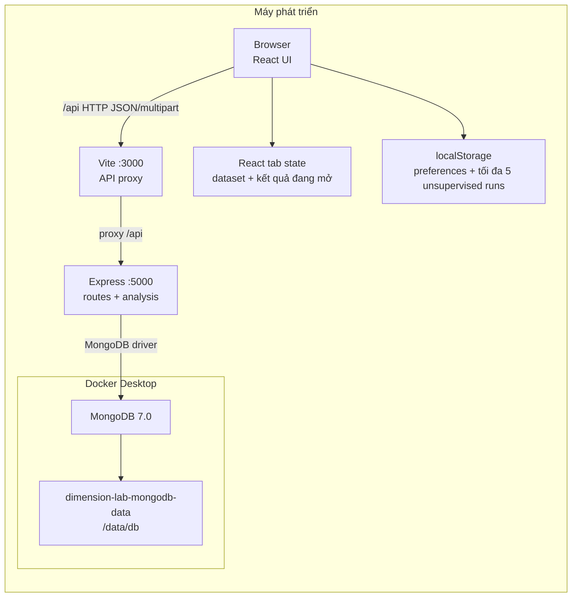
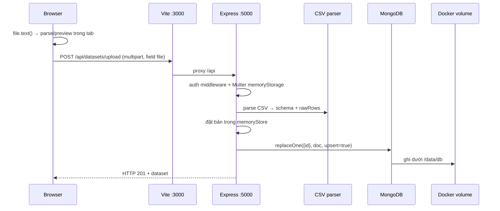

# Docker, MongoDB và luồng dữ liệu Dimension Lab

> **Hướng dẫn lịch sử/tuỳ chọn.** Luồng hiện tại theo yêu cầu dùng MongoDB Community Server cài trực tiếp trên Windows, không dùng Docker. Hãy làm theo [MongoDB native data flow](MONGODB_NATIVE_DATA_FLOW.md) cho cách chạy đang dùng.

Tài liệu này mô tả checkout local `6fbac6c`, phân biệt rõ hiện trạng với phần cần phát triển. Source hiện là React/TypeScript, Vite, Express và MongoDB. Project working rules supplied for this task require JavaScript-only; vì vậy branch mới còn vi phạm quy tắc và chưa nên được xem là bản đã tuân thủ. Source hiện không có Service Worker/IndexedDB cho dataset; offline-first chưa hoàn chỉnh.

## 1. Nói ngắn gọn

- **Docker Desktop** chạy MongoDB; hai thứ này không thay thế nhau.
- **MongoDB** lưu dataset/history/cache của API trong database `cancer_explorer`.
- **Docker named volume** giữ file database dưới `/data/db` để dữ liệu còn sau khi container dừng/tạo lại.
- **Express** nhận API từ browser rồi mới kết nối MongoDB. Browser không kết nối DB trực tiếp.
- File CSV người dùng chọn được đọc và preview trong tab. Khi upload, browser gửi file tới Express; hiện chưa có IndexedDB/outbox để giữ CSV và tự đồng bộ khi offline.

## 2. Kiến trúc đang triển khai



Compose chỉ chứa MongoDB; Vite và Express chạy trong terminal trên máy. Cổng database chỉ bind `127.0.0.1:27017`, không mở ra LAN/Internet. Nếu sau này đưa Express vào Compose, Mongo URI bên trong container phải dùng `mongodb://mongodb:27017/cancer_explorer`, vì `localhost` khi đó trỏ vào chính container API.

## 3. Luồng CSV → MongoDB



Chọn file chỉ tạo bản đang mở trong tab; chưa có nghĩa file được lưu bền. Khi upload, Multer nhận file vào RAM, parser tạo một dataset, rồi repository đặt bản vào RAM trước khi ghi Mongo. Code bắt lỗi Mongo ở repository nên response thành công chưa đảm bảo write đã bền; cần xác minh document trong DB.

## 4. MongoDB được tạo như thế nào?

Lần đầu trên máy mới:

```powershell
docker volume create dimension-lab-mongodb-data
docker compose up -d mongodb
docker compose ps
```

Lần đầu cần Internet để tải `mongo:7.0`. Sau đó image có sẵn trên máy thì container có thể chạy không cần Internet. Compose khai báo volume external để lệnh `docker compose down` không xóa dữ liệu. Không chạy `docker volume rm dimension-lab-mongodb-data` nếu cần giữ DB.

Tạo `.env` nếu chưa có, rồi chạy API và web:

```powershell
if (-not (Test-Path .env)) { Copy-Item .env.example .env }
$env:MONGODB_URI = 'mongodb://127.0.0.1:27017/cancer_explorer'
npm run dev:all
```

Khi Express kết nối, code tạo index và seed hai dataset mẫu nếu chưa tồn tại. MongoDB tạo database/collection khi có ghi đầu tiên. API dùng `localhost:5000`, Vite dùng `localhost:3000`.

Kiểm tra dữ liệu:

```powershell
docker exec dimension-lab-mongodb mongosh cancer_explorer --quiet --eval 'JSON.stringify({ping: db.runCommand({ping: 1}).ok, collections: db.getCollectionNames(), datasets: db.datasets.find({}, {rawRows: 0}).toArray().map(x => ({id: x.id, rows: x.totalRows}))})'
Invoke-RestMethod 'http://localhost:5000/api/system-health' | ConvertTo-Json -Depth 6
```

Đã xác minh trên máy này: `docker compose config --quiet` qua; container `dimension-lab-mongodb` healthy; Mongo ping trả `1`; database có ba collection `datasets`, `experiments`, `compute_cache`; hai mẫu ghi trong DB là `cancer_wdbc` (569 dòng, 30 features) và `wholesale_customers` (440 dòng, 7 features). API ở port 5000 trả health nhưng nhãn engine ghi sai `MongoDB Atlas (Cloud)` và tiến trình đang chạy có thể thuộc checkout khác, nên health này không chứng minh commit latest đã được khởi động.

## 5. Dữ liệu nằm ở đâu?

| Nơi | Chứa | Còn sau reload/restart? | Đồng bộ tự động? |
|---|---|---|---|
| MongoDB `datasets` | metadata và toàn bộ `rawRows` | Có nếu write thành công và volume còn | Không |
| MongoDB `experiments` | cấu hình và metrics tóm tắt | Có nếu write thành công | Không |
| MongoDB `compute_cache` | kết quả cache, TTL 7 ngày | Có theo TTL | Không |
| Docker named volume | database files dưới `/data/db` | Có khi restart/recreate container | Không phải backup |
| Browser `localStorage` | preferences, tối đa 5 unsupervised runs | Cùng browser/origin, phụ thuộc quota | Không |
| React state | file/dataset/result/selection đang mở | Thường mất khi reload/tab đóng | Không |
| Node RAM maps | fallback/cache tạm | Mất khi process dừng | Không |
| IndexedDB/Service Worker | Không có trong source hiện tại | — | — |

## 6. Offline thực tế

| Tình huống | Hành vi |
|---|---|
| Chỉ mất Internet/Wi-Fi; Vite, Express và Docker local đang chạy | Máy vẫn có thể gọi localhost và Mongo local. Đây là trường hợp offline mạng ngoài Internet. |
| Máy mới, chưa cài dependencies hoặc chưa tải Mongo image | Cần tải dependencies/image trước; sau đó mới chạy offline được. |
| Docker/Mongo dừng | API có thể giữ cờ kết nối cũ; health/list không đáng tin cậy. |
| Express dừng | API upload/history/compute không chạy; Mongo data vẫn còn trên volume. |
| DevTools Network = Offline | Browser chặn cả request tới localhost; reload và API calls có thể hỏng. |
| Người dùng đã chọn CSV nhưng chưa upload, rồi reload | CSV có thể mất khỏi tab và phải chọn lại. |

Ứng dụng hiện không phải PWA offline: không có Service Worker cache shell, IndexedDB persistence cho dataset, upload outbox/retry, hay đồng bộ tự động. `analysis.worker.ts` là Web Worker để chạy phân tích, không phải Service Worker. Mục tiêu offline-first của nhóm chưa hoàn chỉnh.

## 7. Giới hạn và rủi ro cần xử lý

- Một dataset lưu toàn bộ `rawRows` trong một MongoDB document; giới hạn BSON là 16 MiB. Thiết kế này không đáp ứng hàng triệu bản ghi. Cần tách metadata và row chunks, dùng pagination/streaming, giới hạn batch và có kiểm tra dung lượng.
- API compute ghép điểm theo thứ tự mảng; payload chưa có stable `recordId` cho từng dòng.
- Khi Mongo lỗi, repository có thể vẫn trả success sau khi chỉ cập nhật RAM. Mongo connection flag cũng có thể stale sau outage.
- `/api/health` hardcode nhãn Atlas kể cả khi URI local.
- Auth chỉ là demo: thiếu Authorization header thì middleware gán admin; token hardcoded, CORS wildcard, body limit 100 MB. Chỉ dùng local, không expose API/DB.
- Offline sync nên làm theo batch: browser persistence (IndexedDB), outbox idempotency key, trạng thái pending/synced/error, retry khi API về. Đây là hướng thiết kế, chưa có trong source.
- Commit latest còn TypeScript/`tsx`, Three.js và một utility Python; xung đột với quy tắc project JavaScript-only/Python-ban rules. Không chạy/gộp source đó cho tới khi nhóm giải quyết policy dependency 3D.

## 8. WHAT · WHY · WHERE · WHEN · HOW

- **WHAT:** Docker chạy MongoDB; volume giữ DB; Express là cầu nối API; Mongo lưu dữ liệu server.
- **WHY:** để dataset/history còn sau khi đóng ứng dụng và restart container.
- **WHERE:** URI `127.0.0.1:27017`; files ở `/data/db` trong volume `dimension-lab-mongodb-data`; API ở `server/`; app ở `src/`.
- **WHEN:** bật Compose trước, sau đó start Express/Vite; Express tạo index/seed lúc kết nối; upload/experiment mới ghi DB.
- **HOW:** Browser → Vite proxy → Express validate/parse → MongoDB driver → Mongo collection → volume; response JSON quay lại Browser.

Tài liệu tiếp: [System Flow](SYSTEM_FLOW.md), [API Design](API_DESIGN.md), [Server module](../server/README.md).
