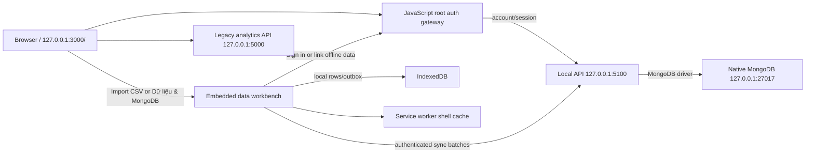

# MongoDB native, account and offline data flow

Local account and CSV storage use the JavaScript API at `127.0.0.1:5100` and MongoDB at `127.0.0.1:27017`. Dimension Lab at `http://127.0.0.1:3000/` has one account form. **Import CSV** in Datasets or Explore and the **Dữ liệu & MongoDB** button open the same embedded importer. An API-verified session enables account-scoped sync. Offline users can save to IndexedDB and choose **Liên kết tài khoản** when ready to sync.

## WHAT — what runs

The browser stores imported CSV rows in IndexedDB first, then syncs batches to MongoDB through the local API. The local API owns account validation, session checks, dataset ownership and server writes. The browser does not connect to MongoDB directly.

## WHY — why it is local-first

- The local IndexedDB copy remains usable when MongoDB/API connectivity is interrupted.
- The outbox retries later; the UI does not claim that a pending write reached MongoDB.
- A separate MongoDB document per row avoids the 16 MiB BSON limit for a single dataset document.
- When offline and server versions conflict, the project policy is offline-wins, after preserving the old server revision in conflict collections.

## WHERE — route and storage

`users` and user-owned datasets live in MongoDB database `cancer_explorer`; the physical MongoDB data folder is set by the native Windows service configuration. The ignored `.env` file holds the local URI/database settings, not browser credentials.

## WHEN — what works

| State | Available | Storage / limitation |
|---|---|---|
| Internet down; Vite, local API and MongoDB running | Local account login/registration, CSV import and server sync | MongoDB plus IndexedDB copy; no Internet required |
| API or MongoDB down | Open existing UI and import/view CSV locally | IndexedDB/outbox; new account and MongoDB confirmation wait until services return |
| Browser has not opened the workbench once | Local app still works while Vite is up | Service worker may not yet cache the workbench shell for a later web-server outage |
| Windows restarted | MongoDB may start as an automatic service | Start Vite and Node APIs again with `npm run dev:all` |
| Vite stopped while Internet is unavailable | Root React app may not reopen | The current service worker caches workbench files, not the full root app bundle |
| Computer shut down | Nothing is serving requests | Data stays on disk; no background sync occurs |

Loss of Internet is different from stopping local services. A local MongoDB connection does not need Wi-Fi, but Vite and the local API must be running for the page and API operations.

## HOW — account validation in MongoDB

1. At the root page, select **Tạo tài khoản local** on the welcome screen to open the form directly, then enter a full name, email and strong password. OTP/SMTP is not used.
2. The JavaScript API validates again, hashes the password with scrypt and a random salt, and inserts the account in MongoDB with `status: "active"`, `authMode: "local"` and `emailVerified: false`.
3. It inserts a hash of the session token with expiry, then sets an HttpOnly/SameSite=Strict cookie.
4. After reload, the gateway calls `/api/auth/me`; the API validates the cookie against the Mongo session. The UI's sessionStorage marker alone does not validate the user.
5. In-app toasts report account checks, completed Mongo writes, session validation and subsequent import/sync stages. They do not send data to Notion.

**Registration timing diagnostic:** one integration run measured 80.35 ms end-to-end, 51.68 ms API total, 40.65 ms scrypt, 2.20 ms user insert and 1.27 ms session insert. This is a single diagnostic sample, not a benchmark. It shows password hashing is the largest share in that sample; do not weaken it. If the user experiences a long wait, the previous user flow's welcome animation or dataset sync may be the visible delay; sync is no longer part of the registration request.

### CSV import and sync

1. Browser parses the CSV stream, generates stable `recordId`/`rowIndex`, and writes to IndexedDB in batches of 250.
2. When API, MongoDB and a valid session are available, it sends metadata, row batches of at most 500 and a finish request.
3. The API stages rows under the sync ID, checks the actual row count, and publishes the complete generation through a conditional metadata update. Replaying a completed sync returns its previous acknowledgement.
4. Failed sync preserves the local copy/outbox; the UI reports pending/error status.
5. A stale base revision archives the current server version before publication. A future base revision returns `409` and leaves the local data pending.
6. Datasets and Explore use the signed-in account to load a published revision. The browser runs private analysis and saves its experiment through the same local API.

Progress notifications are driven by measured pipeline events and actual counts, not fabricated percent complete.

## Collections in `cancer_explorer`

| Collection | Stored data | Ownership/check |
|---|---|---|
| `users` | Account ID, normalized email, full name, active status, local auth mode, unverified-email flag, password salt/hash | unique normalized email |
| `sessions` | SHA-256 token hash, user ID and expiry | authenticated user |
| `user_datasets` | Dataset metadata, revision, row count and sync state | `ownerId` + dataset ID |
| `user_dataset_rows` | Rows written by the previous workbench | `ownerId` + dataset ID + record ID |
| `user_dataset_revision_rows` | Rows staged and published by sync ID | owner + dataset + sync ID + record ID |
| `user_dataset_row_edits` | Versioned overrides for online row edits | owner + dataset + row generation + record ID |
| `dataset_versions` | Completed revision manifest | owner + dataset |
| `dataset_sync_receipts` | Acknowledgements of earlier completed sync IDs | owner + dataset + sync ID |
| `dataset_conflicts`, `dataset_conflict_rows` | Preserved prior server revision | owner + conflict ID |
| `user_experiments` | Private history referencing the analysed dataset revision | owner + dataset + revision |
| `datasets`, `experiments`, `compute_cache` | Legacy analysis data | old analytics API; separate from user-owned CSV records |

## Native MongoDB setup and local checks

1. Ensure MongoDB Community Server is installed and running as a Windows service.
2. Ensure `.env` uses a loopback URI such as `mongodb://127.0.0.1:27017/cancer_explorer`.
3. Start local services from the project folder with `npm run dev:all`.
4. Open **http://127.0.0.1:3000/**. The **Dữ liệu & MongoDB** launcher opens local-only mode immediately; register/sign in on the root page to enable account-scoped MongoDB sync. Open the workbench once to prepare its service-worker cache.
5. Check `http://127.0.0.1:5100/api/health` and run `npm run test:local-db`.

A green health check only proves the service can ping MongoDB. The local API tests use an isolated test database; they do not create or prove a real account in the user's main database.

## Limits and data protection

- Local registration does not verify mailbox ownership. Keep it on loopback; do not expose port 5100.
- Do not expose MongoDB port 27017 or legacy API port 5000 to the Internet.
- IndexedDB values are not encrypted by this implementation; the Windows account/browser profile is the local boundary.
- CSV rows are stored in bounded documents, but disk space, browser quota, transfer throughput and compute RAM still constrain scale.
- Explore accepts CSV datasets with enough usable numeric features for 3D. Image and multimodal ingestion are outside the CSV workflow.
- No Notion integration is used. User notifications are in the project UI.

Related: [System Flow](SYSTEM_FLOW.md), [API Design](API_DESIGN.md), [Server module](../server/README.md).
