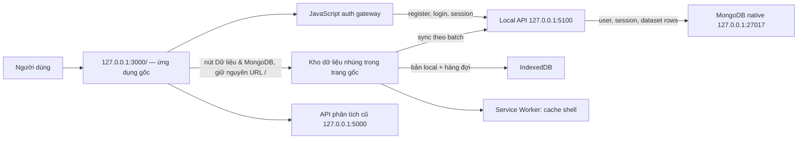

# System Flow — root auth, local MongoDB and offline workspace

**Trạng thái triển khai (10/11/2026):** tài khoản local và kho CSV dùng JavaScript API tại `127.0.0.1:5100` cùng MongoDB native tại `127.0.0.1:27017`. Người dùng vào từ `http://127.0.0.1:3000/`. Gateway JavaScript tích hợp form đăng nhập/đăng ký vào màn hình gốc; nút **Dữ liệu & MongoDB** mở kho dữ liệu ngay trong trang gốc, không đổi URL; nếu API/MongoDB đang tắt, vẫn có thể dùng chế độ local-only. MongoDB local đã được kiểm tra hoạt động; bộ kiểm thử API đăng ký dùng database cô lập.

## WHAT — hệ thống gồm những gì

- **Giao diện gốc:** ứng dụng React hiện có tại `/`, cộng với `src/local-auth-gateway.js` để đăng nhập/đăng ký bằng local API.
- **Tài khoản:** API JavaScript tại `127.0.0.1:5100` kiểm tra họ tên/email/mật khẩu, ghi user và session vào MongoDB. Không cần OTP; `emailVerified` luôn là `false` ở chế độ local.
- **Kho dữ liệu:** CSV được đọc theo luồng trên trình duyệt, ghi vào IndexedDB trước, rồi đồng bộ theo lô tới MongoDB khi API và MongoDB sẵn sàng.
- **Thông báo:** toast trong ứng dụng báo bước đã hoàn tất, số dòng thực tế, cảnh báo, thời gian API và trạng thái đồng bộ. Không gửi nội dung sang Notion hay dịch vụ thông báo bên ngoài.

## WHY — vì sao luồng này được thiết kế như vậy

- Trình duyệt không kết nối trực tiếp tới MongoDB và không giữ mật khẩu MongoDB.
- Đăng ký chỉ thành công khi MongoDB lưu user và session thành công; API lỗi thì giao diện báo lỗi thay vì tạo trạng thái thành công giả.
- IndexedDB giữ bản local khi mất kết nối; MongoDB nhận các batch khi dịch vụ local hoạt động lại.
- Mật khẩu vẫn dùng scrypt. Không giảm độ mạnh của hàm băm để tiết kiệm vài chục mili giây; phép đo cho thấy phần lớn thời gian đăng ký hiện nằm ở bước hash.

## WHERE — dữ liệu đi qua đâu



Gateway nhúng giao diện workbench vào Dimension Lab qua Shadow DOM. **Import CSV** ở Datasets, Explore và nút **Dữ liệu & MongoDB** mở cùng một trình nhập. Workbench dùng form tài khoản của trang gốc. Người dùng chưa đăng nhập có thể lưu CSV trong IndexedDB rồi chọn **Liên kết tài khoản** để đồng bộ.

## HOW — đăng ký và xác thực tài khoản

1. Tại `/`, người dùng có thể nhấn nút **Tạo tài khoản local** ngay trên màn chào mừng để mở form thẳng, hoặc mở form đăng nhập rồi chuyển chế độ. Form yêu cầu họ tên đầy đủ, email đăng nhập và mật khẩu mạnh; không gửi OTP.
2. Trình duyệt kiểm tra đầu vào cơ bản. API kiểm tra lại: họ tên có ít nhất hai phần; mật khẩu từ 14 ký tự, có chữ hoa, chữ thường, số và ký tự đặc biệt.
3. API băm mật khẩu bằng scrypt với salt ngẫu nhiên, ghi user (`status: "active"`, `authMode: "local"`, `emailVerified: false`) vào `users`, rồi ghi hash của token và hạn dùng vào `sessions`.
4. API gửi cookie `HttpOnly`/`SameSite=Strict`. Cờ `sessionStorage` chỉ giúp React mở giao diện; nó không chứng minh danh tính. Sau reload, gateway gọi `/api/auth/me`; API xác thực cookie/session với MongoDB.
5. Khi xác thực thành công, ứng dụng mở workspace. Nếu form được mở từ kho dữ liệu, ứng dụng quay lại kho để tiếp tục nhập hoặc liên kết dữ liệu offline. Toast phản ánh kết quả trả về từ API.

Email chỉ là tên đăng nhập, chưa chứng minh quyền sở hữu hộp thư. Chế độ này chỉ bind loopback; không mở API đăng ký cho LAN/Internet.

### Đăng ký có chậm không?

Một lần kiểm tra local trong bộ integration test ghi nhận: **80.35 ms** từ trình duyệt, **51.68 ms** tổng API, trong đó scrypt **40.65 ms**, ghi user **2.20 ms**, tạo session **1.27 ms**. Đây là số đo chẩn đoán của một lượt chạy, không phải benchmark; tổng thời gian khởi động bộ test dài hơn vì còn khởi động server và chạy các ca khác. Số liệu này không cho thấy MongoDB đang là điểm nghẽn. Nếu người dùng thấy chờ lâu, nguyên nhân có thể là hoạt ảnh màn chào mừng hoặc việc chờ đồng bộ dữ liệu sau đăng nhập; đồng bộ đã được tách khỏi bước xác thực. Không hạ thông số scrypt.

## HOW — nhập dữ liệu, lưu và đồng bộ

1. Mở **Datasets → Import CSV** hoặc **Dữ liệu & MongoDB** và chọn CSV. Cùng một parser đọc luồng byte và giữ `recordId`/`rowIndex` ổn định.
2. Ghi mỗi batch vào IndexedDB trước; chỉ thông báo local-saved khi giao dịch ghi hoàn tất.
3. Khi API/session/MongoDB sẵn sàng, gửi manifest, từng batch tối đa 500 dòng, rồi gọi finish để server kiểm tra số dòng.
4. MongoDB công bố revision sau khi số dòng khớp. Bản offline dựa trên revision cũ được áp dụng sau khi lưu bản server. Revision đi trước server trả `409`.
5. Lỗi hoặc mất kết nối giữ dữ liệu local/outbox để thử lại; UI hiển thị đang chờ hoặc lỗi, không báo đồng bộ thành công.
6. Trong Datasets hoặc Explore, chọn CSV đã đồng bộ của tài khoản để đọc revision hoàn tất và chạy phân tích trong trình duyệt. Lịch sử riêng tham chiếu đúng revision đã chạy.

Toast phản ánh event thật của pipeline: đọc/kiểm tra, lưu local, đang đồng bộ, đã đồng bộ, đã cache, chờ kết nối hoặc lỗi. Không tạo phần trăm tiến độ giả.

## WHEN — hoạt động trong từng tình huống

| Tình huống | Việc vẫn làm được | Lưu ở đâu / giới hạn |
|---|---|---|
| Mất Internet nhưng Vite, API và MongoDB trên máy còn chạy | Đăng ký/đăng nhập local, nhập và đồng bộ CSV | User/dataset trên MongoDB local; có bản IndexedDB |
| API hoặc MongoDB dừng | Mở UI đã tải, nhập/xem dữ liệu local | IndexedDB; không thể tạo tài khoản mới hoặc xác nhận sync server |
| Máy vừa bật nhưng Vite/API chưa chạy | MongoDB service có thể tự chạy; trang web chưa được phục vụ | Chạy lại `npm run dev:all` |
| Vite đã dừng và Internet cũng mất | Root React shell không được đảm bảo mở lại | Service worker hiện cache tài nguyên workbench, chưa precache toàn bộ root React bundle |
| Trình duyệt chưa mở kho dữ liệu lần nào | Import trong khi app local còn chạy vẫn dùng được | Service worker chưa cache shell workbench; cần mở kho một lần để chuẩn bị dùng khi server web dừng |
| Máy tắt/ngủ | Không có request đang chạy | Dữ liệu trên đĩa; MongoDB service khởi động lại theo cấu hình Windows |

## WHERE — MongoDB lưu gì

Database mặc định `cancer_explorer`:

| Collection | Nội dung |
|---|---|
| `users` | id, email chuẩn hóa, họ tên, trạng thái `active`, auth mode, cờ email chưa xác minh, salt/hash scrypt |
| `sessions` | hash token, userId, thời hạn |
| `user_datasets` | metadata dataset, ownerId, revision và trạng thái sync |
| `user_dataset_rows` | các dòng từ workbench trước khi dùng revision rows |
| `user_dataset_revision_rows` | các dòng theo sync ID, recordId/rowIndex và giá trị CSV |
| `user_dataset_row_edits` | các lần sửa dòng theo phiên bản |
| `dataset_versions` | manifest revision đã hoàn tất |
| `dataset_sync_receipts` | xác nhận các lượt đồng bộ đã hoàn tất |
| `dataset_conflicts`, `dataset_conflict_rows` | bản server được lưu trước khi bản offline ghi đè |
| `user_experiments` | lịch sử phân tích của tài khoản và revision đã chạy |

MongoDB giới hạn một BSON document 16 MiB; mỗi dòng được lưu riêng để tránh nhét cả CSV vào một document. Điều đó không loại bỏ giới hạn dung lượng ổ đĩa, quota IndexedDB, thời gian truyền hoặc RAM phân tích.

## Giới hạn hiện tại cần biết

- Kho tài khoản/dataset hiện xử lý CSV/bảng. Ảnh và dữ liệu đa phương thức chưa có ingestion/embedding.
- Dataset riêng xuất hiện trong Datasets và Explore sau khi đồng bộ xong. Mở dataset để kiểm tra điều kiện đầu vào rồi chạy PCA/3D.
- Chưa cam kết xử lý PCA/clustering hàng triệu dòng trên máy yếu; cần sampling/LOD có công bố số nguồn và số điểm render trước khi mở rộng.
- Không có Notion integration trong luồng này. Toast nằm trên trang project.
- Không commit, push hay deploy.

## Chạy và kiểm tra

```powershell
npm run dev:all
```

Mở **http://127.0.0.1:3000/**. Nút **Dữ liệu & MongoDB** luôn có sẵn để mở kho CSV local-only; tạo/đăng nhập tài khoản tại màn hình gốc để bật sync theo user. Không cần truy cập `/database.html` trong thao tác người dùng thông thường.

```powershell
Invoke-RestMethod 'http://127.0.0.1:5100/api/health' | ConvertTo-Json -Depth 4
npm run test:local-db
```

Health chỉ xác nhận service/ping hiện tại; bộ test tích hợp mới xác nhận register/login/session với MongoDB test riêng. Không dùng test này để kết luận một user thật đã được tạo trong database chính.

Tài liệu liên quan: [MongoDB native data flow](MONGODB_NATIVE_DATA_FLOW.md), [API Design](API_DESIGN.md), [Server README](../server/README.md).
